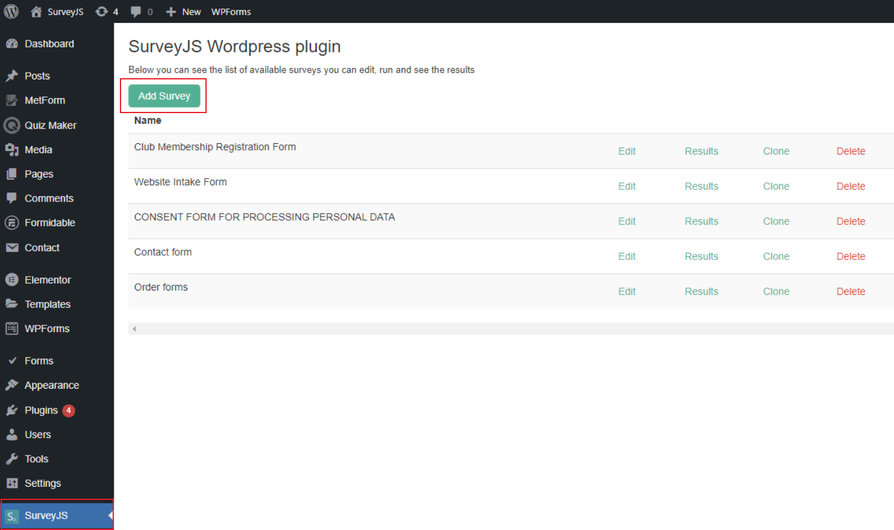
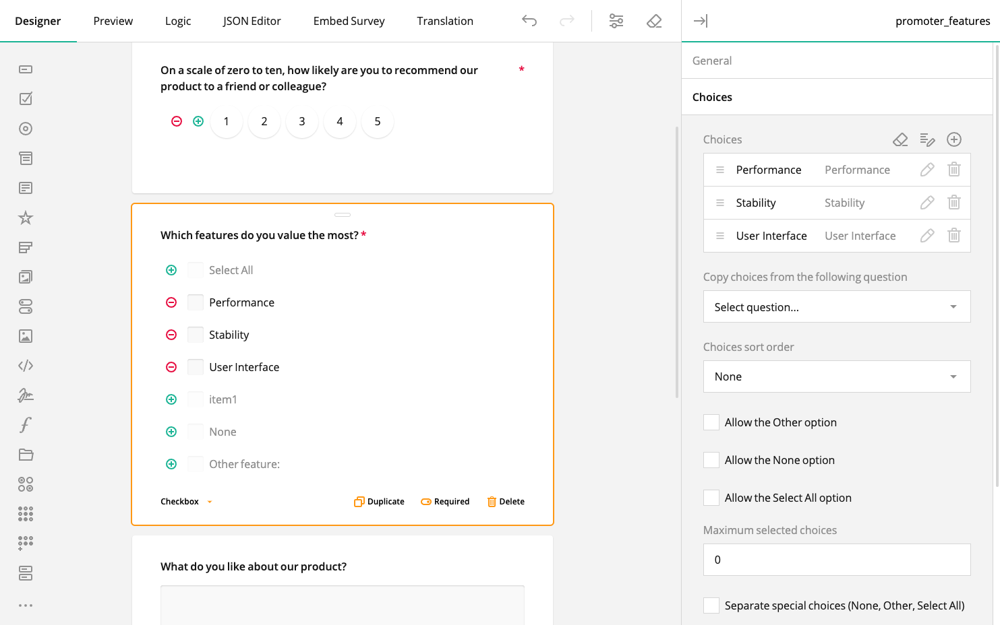
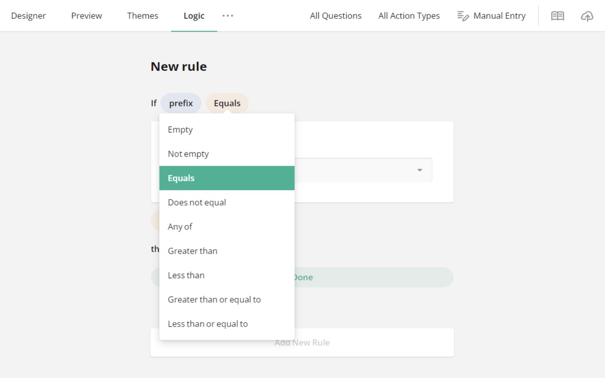
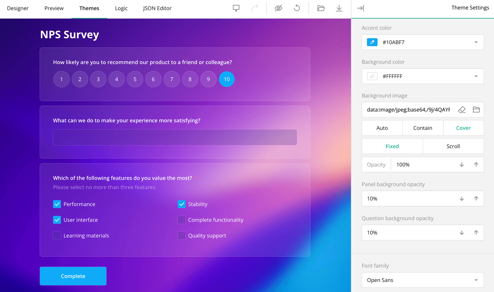
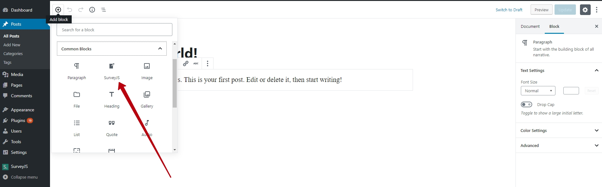
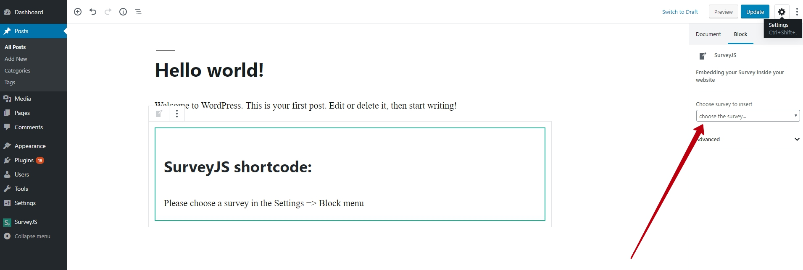
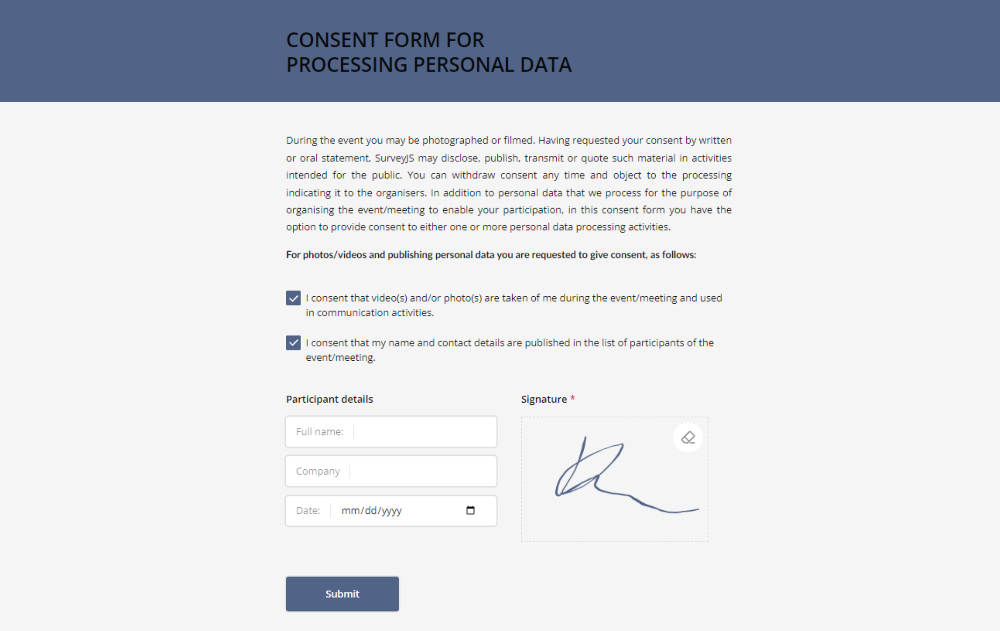

# SurveyJS Forms - Contact Forms, Survey & Form Builder & More

SurveyJS Forms is a WordPress plugin for contact forms, surveys, quizzes and multi-page forms. Forms run on the open-source [SurveyJS Form Library](https://surveyjs.io/form-library) and are added to pages with a block or a shortcode. Entries, emails and uploaded files stay on your site.

The plugin version is the version of the SurveyJS libraries it ships (currently 3.2.4).

**SurveyJS Forms Pro** is a free add-on downloaded from [surveyjs.io/wordpress-pro](https://surveyjs.io/wordpress-pro). It adds Survey Creator (the visual form designer), PDF export and analytics. Survey Creator moved from this plugin to Pro in 3.2.4, because WordPress.org hosts only GPL-licensed code and Survey Creator is a commercial SurveyJS component.

## Features

### Forms and the form editor

- **SurveyJS Forms** menu: All Forms (search, sorting, bulk delete; row actions Edit, Results, Clone, Save as Template, Delete), Add New Form, Getting Started, Settings.
- **Form templates**: Add New Form starts from a blank form, a built-in template or your own template, with categories, search and a live preview. Templates come from [surveyjs/templates](https://github.com/surveyjs/templates) and ship with the plugin; nothing is downloaded. **Save as Template** saves any form as your own template (My Templates).
- **Form editor** tabs: Config (form JSON), Theme, Email, Entries. JSON is edited in a code editor (Monaco) with validation hints, a Format button and a live preview. Images from the Media Library can be inserted or set as the form logo.
- **Open in free UI Builder**: edit the form in the free online visual builder on surveyjs.io; on save, the JSON comes back to the editor. Optional, the plugin works fully without it.
- **Themes**: the default **Adaptive** theme takes the colors, fonts, buttons and fields of your WordPress theme. **AI themes**: copy a prompt with your site's styles into your own AI assistant and paste back a SurveyJS theme; the plugin keeps only valid tokens and warns about low text contrast. The plugin never sends anything to an AI service. [Predefined SurveyJS themes](https://surveyjs.io/form-library/documentation/manage-default-themes-and-styles#add-surveyjs-themes-to-your-application) are also available.
- **Per-form options**: Markdown in form texts, Save & Resume (visitors continue in the same browser, logged-in users on any device), GDPR agreement checkbox, CAPTCHA.
- **Adding a form to a page**: the **SurveyJS** block, or the shortcode `[surveyjs id="1"]` (the old `[Survey id="1"]` still works).
- **Importers** for forms (and entries, where available) from WPForms, Contact Form 7, Ninja Forms and Fluent Forms.

### Email

- **Email notification** to the site owner: Send To, From Name, From Email, Reply-To (an email question of the form), Subject, Message.
- **Auto-reply** to the respondent, sent to the address from the Reply-To question.
- **Tags** in Subject and Message: `{all_fields}`, `{field:question_name}`, `{form_name}`, `{site_name}`, `{admin_email}`.
- **HTML emails**, **file attachments** (files from a File Upload question, up to 18 MB in total per email) and a **Send test email** button.
- New forms get the email notification turned on, with Reply-To set to the first email question. Delivery uses `wp_mail`, so it depends on the site's mail setup.

### Entries

- Entries are stored in WordPress (can be turned off per form). Entries table with a column per question, entry view, delete and CSV export.
- **Partial entries** (off by default): answers of multi-page forms are saved on each next page and listed under Partial until the form is submitted. Unfinished entries are deleted after 30 days unless you click Keep.

### Spam protection and privacy

- Hidden honeypot field on every form. Optional CAPTCHA: Google reCAPTCHA v2/v3 or Cloudflare Turnstile.
- GDPR agreement checkbox linked to your Privacy Policy page.
- Entries work with Tools > Export Personal Data and Tools > Erase Personal Data.
- IP addresses are not stored unless you turn this on in Settings.
- Uninstall keeps forms, entries and files unless you turn on deletion in Settings.

### File uploads

- Files are saved to `wp-content/uploads/surveyjs/` with random names; PHP execution there is blocked and the files are open only to administrators.
- Allowed types: images, PDF, Office/OpenDocument files, TXT, CSV. Max size: 10 MB per file or the server limit, whichever is lower.
- Files are deleted together with their entry or form; files of forms that were never submitted are removed by a daily cleanup.

### Form Library

Forms support everything the SurveyJS Form Library renders, for example:

- Question types: [Single-Select Dropdown](https://surveyjs.io/form-library/examples/create-dropdown-menu-in-javascript/), [Multi-Select Dropdown (Tag Box)](https://surveyjs.io/form-library/examples/how-to-create-multiselect-tag-box/), [Image Picker](https://surveyjs.io/form-library/examples/image-picker-question/), [Multiple Textboxes](https://surveyjs.io/form-library/examples/multiple-text-box-question/), [Ranking](https://surveyjs.io/form-library/examples/add-ranking-question-to-form/), [Select Items to Rank](https://surveyjs.io/form-library/examples/select-items-to-rank/), [HTML](https://surveyjs.io/form-library/examples/questiontype-html/), [Image Capture](https://surveyjs.io/form-library/examples/photo-capture/), [Single-Select Matrix](https://surveyjs.io/form-library/examples/single-selection-matrix-table-question/), [Multi-Select Matrix](https://surveyjs.io/form-library/examples/questiontype-matrixdropdown/), [Dynamic Matrix](https://surveyjs.io/form-library/examples/questiontype-matrixdynamic/), [Signature](https://surveyjs.io/form-library/examples/signature-pad-widget-javascript/).
- [Calculations](https://surveyjs.io/form-library/examples/questiontype-matrixdynamic-totals/), [carry forward responses](https://surveyjs.io/form-library/examples/survey-carry-forward/), [table of contents](https://surveyjs.io/form-library/examples/table-of-contents/), [progress bar](https://surveyjs.io/form-library/examples/configure-form-navigation-with-progress-indicators/), [input validation](https://surveyjs.io/form-library/examples/javascript-form-validation/), [panels](https://surveyjs.io/form-library/examples/set-properties-on-multiple-questions-using-panel/), [duplicate groups](https://surveyjs.io/form-library/examples/dynamic-matrix-table-question-with-dropdown-cell-type/), [multi-file upload](https://surveyjs.io/form-library/examples/file-upload/), [join identifier](https://surveyjs.io/form-library/examples/merge-question-values/).
- Display and skip logic: for example, the [visibility of the next question](https://surveyjs.io/form-library/examples/conditional-logic-and-branching-in-surveys/) or the [text of the Thank you page](https://surveyjs.io/form-library/examples/nps-question/) based on the answers.

See also the [featured demos](https://surveyjs.io/form-library/examples/overview).

## Screenshots

The screenshots were taken before 3.2.4. Screenshots 2–4 show Survey Creator, which is now in SurveyJS Forms Pro.

**Admin UI with your SurveyJS forms:**



**Survey Creator: drag-and-drop form building (SurveyJS Forms Pro):**



**Survey Creator: GUI for conditional rules (SurveyJS Forms Pro):**



**Survey Creator: Theme Editor (SurveyJS Forms Pro):**



**Add a block with your SurveyJS form:**



**Embed and publish your form:**



**View the result:**



## Requirements

- WordPress 6.5 or later (tested up to 7.1).
- PHP 8.2 or later.
- Self-hosted WordPress or a WordPress.com plan that supports plugins.

## Installation

**Install the plugin from the WordPress directory**

1. Inside your admin area, go to Plugins > Add New Plugin.
1. Search for "surveyjs".
1. Click Add New Plugin and then click Install now.
1. Once installed, activate the plugin.

**Upload & Install the plugin using the WordPress admin plugin upload**

1. Go to the [WordPress.org plugin repository](https://wordpress.org/plugins/surveyjs/) and search for the SurveyJS plugin.
1. Download the zip file with the plugin.
1. Inside your admin area, go to Plugins > Add New Plugin.
1. Click Upload Plugin and then click Install now.
1. Once installed, activate the plugin.

**SurveyJS Forms Pro (optional)**

Download the zip from [surveyjs.io/wordpress-pro](https://surveyjs.io/wordpress-pro) (also linked from the **Get Pro – Free** menu item) and install it with Upload Plugin. Pro requires SurveyJS Forms. On Multisite, network-activate Pro.

**Protect uploaded files on Nginx**

On Apache the plugin blocks direct access to `wp-content/uploads/surveyjs/` with an `.htaccess` file. Nginx does not read `.htaccess`, so add this rule to the `server` block of your site and reload Nginx:

```nginx
location ^~ /wp-content/uploads/surveyjs/ { deny all; }
```

## Updates (SurveyJS Forms and SurveyJS Forms Pro)

SurveyJS Forms and SurveyJS Forms Pro are always released together, with the same version number as the SurveyJS libraries (for example, 3.2.4). Releases are backward compatible, so always install the latest versions.

- **SurveyJS Forms** updates from the WordPress.org directory as usual: manually or with WordPress auto-updates.
- **SurveyJS Forms Pro** is not in the directory and follows SurveyJS Forms. When SurveyJS Forms is updated (single, bulk or auto-update) and the update succeeds, Pro downloads the latest zip from surveyjs.io at the end of the same request and installs itself over the old copy. Pro stays active. While a SurveyJS Forms update is pending, its row on the Plugins screen says "SurveyJS Forms Pro will be updated to the same version automatically." After an update on the Plugins screen, the Pro row shows the new version without a page reload.
- **No information about your site is sent**: the download is a plain request with the user agent `SurveyJS-Forms-Pro/<version>`.
- **A failed Pro download never affects the SurveyJS Forms update.** The error is saved and shown in the version notice.
- **Version notice.** When the versions differ, Pro shows a notice on all admin pages with one button, for the older plugin only:
  - SurveyJS Forms older: "Please update SurveyJS Forms" with the button **Update SurveyJS Forms** (the standard update from the directory).
  - SurveyJS Forms Pro older (the download failed, or an old Pro zip was installed by hand): "Please update SurveyJS Forms Pro" with the button **Update SurveyJS Forms Pro**, the last error if any, and **Download from surveyjs.io** as a fallback.

  Nothing is turned off while the versions differ.
- **Self-updating of Pro is turned off** on WordPress VIP, when file changes are not allowed (`DISALLOW_FILE_MODS`), with `define( 'SURVEYJS_PRO_DISABLE_UPDATES', true );` or with the filter `surveyjs_pro_self_update` returning `false`. Then Pro never downloads anything, the notice has no Pro update button, and both plugins are updated in your code repository.
- Pro has the header `Update URI: https://surveyjs.io/wordpress-pro`, so WordPress.org never offers another plugin with the slug `surveyjs-pro` as its update.

**Release order:** first upload the Pro zip to `https://surveyjs.io/Content/Downloads/wordpress/surveyjs-pro.zip` (fixed URL, always the latest Pro, one top folder `surveyjs-pro/`), then publish SurveyJS Forms to WordPress.org. Implementation details: `includes/updater.php` and the "Updates" section of README.md in the Pro repository.

## For developers

### Hooks for SurveyJS Forms Pro

SurveyJS Forms owns all data (the `sjs_form` post type and the `{prefix}sjs_results` table) and exposes generic hooks; Pro adds its features through them. Without anything hooked in, the plugin behaves as before. The full contract (constants, admin pages, the `window.surveyjsEditor` JavaScript API, every hook with its arguments) is described in the Pro repository's README.md, section "Developer: the extension contract in SurveyJS Forms (Base)".

- Actions: `surveyjs_admin_menu`, `surveyjs_admin_enqueue_scripts`, `surveyjs_register_settings`, `surveyjs_render_editor`, `surveyjs_editor_email_rows`, `surveyjs_render_results_view`, `surveyjs_results_title_actions`, `surveyjs_entries_bulk_action_<action>`, `surveyjs_enqueue_form_assets`, `wp_surveyjs_save_result`.
- Filters: `surveyjs_editor_tabs`, `surveyjs_form_settings_defaults`, `surveyjs_form_settings_sanitize`, `surveyjs_form_row_actions`, `surveyjs_results_views`, `surveyjs_entry_row_actions`, `surveyjs_entries_bulk_actions`, `surveyjs_form_client_config`, `surveyjs_save_result_response`, `surveyjs_notification_attachments`, `surveyjs_notification_tags`, `surveyjs_form_locale`, `surveyjs_show_pro_upsell`.
- Other settings: `SURVEYJS_SITE_URL` constant / `surveyjs_site_url` filter (surveyjs.io address, default `https://surveyjs.io`; the UI Builder, Pro page and Pro download URLs are built from it), `surveyjs_allowed_upload_extensions`, `surveyjs_max_upload_size`, `surveyjs_unattached_upload_lifetime`, `surveyjs_partial_entry_lifetime`, `surveyjs_entry_ip`, `surveyjs_import_entries_per_request`.

### External services

All of them are optional; form answers are never sent to them.

- **SurveyJS UI Builder** (surveyjs.io): only when the user clicks Open in free UI Builder. The form ID, name, form JSON and theme JSON are sent. [Terms of Use](https://surveyjs.io/terms-use), [Privacy Policy](https://surveyjs.io/privacy-policy).
- **Google reCAPTCHA** and **Cloudflare Turnstile**: only when chosen in Settings and turned on for a form. See "External services" in `src/trunk/readme.txt`.
- **SurveyJS Forms Pro** downloads its updates from surveyjs.io (see [Updates](#updates-surveyjs-forms-and-surveyjs-forms-pro)).

### Development

- Plugin source: `src/trunk` (published to WordPress.org); WordPress.org assets: `src/assets`. The user-facing readme is `src/trunk/readme.txt`.
- Tests (Playwright): `npm run test:unit`, `npm run test:e2e`. The e2e tests run against the demo site (`demo/`, `docker compose`, http://localhost:9876; override with `WP_BASE_URL`, `WP_USERNAME`, `WP_PASSWORD`, `MAILPIT_URL`; set `WP_CONTAINER` for the tests that run PHP in the container).
- Templates: `npm run update-templates [-- <local checkout>]` replaces `src/trunk/templates/` with the templates repository (latest commit or a local checkout); `source.txt` records the commit.

**Update test site** (`sandboxes/pro-update-test/`, http://localhost:9905, user `sandbox` / password `sandbox`). Run the scripts in Git Bash with Docker running.

- `setup.sh` starts the containers, installs WordPress and runs `reset.sh`.
- `reset.sh [mode]` copies SurveyJS Forms from `git/surveyjs-wordpress/src/trunk` and Pro from the `git/surveyjs-wordpress-pro` working tree into the site, offers SurveyJS Forms with the version `<current>.1` as an update, and serves a Pro zip with the same version instead of the surveyjs.io download. Modes:
  - no mode: both plugins have the same version; update SurveyJS Forms and check that Pro follows.
  - `base-older`: the installed Pro gets the version 9.9.9, so the notice asks to update SurveyJS Forms.
  - `pro-older`: the installed Pro gets the version 0.0.1, so the notice asks to update SurveyJS Forms Pro.
- Failures are simulated with the site options `pro_update_test_bad_download` (Pro download fails), `pro_update_test_no_loopback`, `pro_update_test_no_offer`; `pro_update_test_use_staging` downloads Pro from the `SURVEYJS_SITE_URL` set in `docker-compose.yml` instead of the local zip. Pro downloads are logged to `wp-content/uploads/pro-update-test/requests.log` in the container.

## Licensing

> Licensing is being revised.

The SurveyJS plugin demonstrates how SurveyJS UI libraries can be integrated into a WordPress environment. It includes the MIT-licensed **Form Library** for rendering forms. **Survey Creator**, a form-building UI component, is not part of this plugin; it is in the separate SurveyJS Forms Pro add-on.

The SurveyJS product family _also_ includes:

- **PDF Generator** – Exports forms as editable PDF files.
- **Dashboard** – Enables the creation of custom survey data dashboards populated with user responses.

Survey Creator, PDF Generator, and Dashboard are proprietary libraries. The PDF Generator and Dashboard libraries are **not** integrated into the SurveyJS plugin by default but can be added if needed.

The SurveyJS plugin is free under the following conditions:

✅ You use it **as is** (without modifying the integrated form builder).\
✅ You do **not** integrate PDF Generator or Dashboard.\
✅ You [self-host WordPress](https://wordpress.com/go/website-building/wordpress-com-vs-wordpress-org/).

If you use WordPress.com, the plugin is only free for users on the Business plan or higher due to platform [limitations](https://www.wpbeginner.com/beginners-guide/what-are-the-limitations-of-wordpress-com/). Please see [WordPress.com vs. WordPress.org](https://wordpress.com/go/website-building/wordpress-com-vs-wordpress-org/) to learn more.

If you plan to **fork** the plugin to modify Survey Creator **or** integrate PDF Generator and/or Dashboard, you must purchase a [developer license](https://surveyjs.io/pricing) for each developer involved in the integration and working with the SurveyJS API.

See [LICENSE.md](LICENSE.md) and [LIMITATION OF REDISTRIBUTION.md](LIMITATION%20OF%20REDISTRIBUTION.md).

## Release Notes

Check out SurveyJS [Release Notes](https://surveyjs.io/stay-updated/release-notes) to keep yourself informed about our latest enhancements and new features introduced every week.

## Support

* [View Support Forum](https://wordpress.org/support/plugin/surveyjs)
* [Visit SurveyJS Support Page](https://surveyjs.io/support)

## Our web sites

* [https://surveyjs.io/](https://surveyjs.io/)
* [http://devsoftbaltic.com/](http://devsoftbaltic.com/)

## Contact us

info@devsoftbaltic.com
